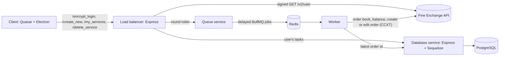

# Fine Exchange AOM: client

Fine Exchange AOM (automated order manager) let market makers run trading tasks on Fine Exchange, the crypto exchange my UK company, Fine Exchange Ltd, ran in 2022. A trader connected an exchange API key and set up a task: a trading pair, buy or sell, a spread from the top of the order book, an order size and an interval. The back end then kept a limit order at that spread, moving it as the book moved, until the trader stopped the task.

This repository is the client. It's one of five that make up the system (see below). I built all of them between March and July 2022.

[Watch the demo](https://www.youtube.com/watch?v=5utpoACchuE) · [Read the docs](https://gallant-raman-c19d28.netlify.app/docs/aom_docs/get_started/)

> **Status: shut down.** Fine Exchange closed in 2022 and the fine.exchange domain has since expired, so it's no longer mine. The code still names `api.fine.exchange` and an Okteto development host. Read it, but don't run it with real API keys.

## The system

| Repository | Role |
| --- | --- |
| [Fine-Exchange-AMM](https://github.com/VitalJeevanjot/Fine-Exchange-AMM) (this one) | Client: Quasar 2 and Vue 3, packaged for desktop with Electron |
| [fine-ex-amm-backend-load-balancer](https://github.com/VitalJeevanjot/fine-ex-amm-backend-load-balancer) | The API the client calls: checks the user's exchange key, enforces task limits and spreads tasks across queue servers |
| [fine-ex-amm-backend-queue-jobs-1](https://github.com/VitalJeevanjot/fine-ex-amm-backend-queue-jobs-1) | Queue service: schedules each task's runs as BullMQ jobs on Redis |
| [fine-ex-amm-backend-worker-jobs-1](https://github.com/VitalJeevanjot/fine-ex-amm-backend-worker-jobs-1) | Worker: runs the jobs and places or moves the orders through CCXT |
| [fine-ex-amm-backend](https://github.com/VitalJeevanjot/fine-ex-amm-backend) | Database service: stores tasks in PostgreSQL and cancels orders when a task is deleted |
| [Docs site](https://gallant-raman-c19d28.netlify.app/docs/aom_docs/introduction/) | The product and API docs, built with Hugo. Its source repository is private. |



## How a task runs

1. **Connect a key.** The client sends the trader's exchange API key and secret to `/encrypt_login`. The load balancer checks them with a signed request to the exchange's `/v2/user` endpoint, then returns them encrypted with cryptr. The client keeps that encrypted login and sends it with later requests.
2. **Create a task.** `/create_new` asks the database service for the trader's tasks and refuses a sixth one. It then hands the task to the next queue server in turn (round robin across `MAX_SERVERS`).
3. **Schedule it.** The queue service checks the order book and adds a delayed `createOrder` job to the BullMQ `tasks` queue. When a job finishes, it adds the next one after the task's interval, until the task is stopped.
4. **Place the order.** The worker reads the top five levels of the book. A buy goes at the best bid minus the spread, a sell at the best ask plus the spread, sized as a percentage of the free balance. The first run creates the order and later runs edit it.
5. **Keep the record.** The database service stores each task with its keys encrypted, records the latest order id, and cancels the open order through CCXT when the task is deleted.

The services log with winston, encrypt the payloads they log, and ran as Okteto development environments on Kubernetes (`okteto.yml` in each repository).

## The client

- `src/pages/Index.vue`: the task list and the main screen.
- `src/components/operations/`: adding and removing API keys, the create-task form and settings.
- `src/components/pinManagers/`: the app PIN and the PIN prompts before adding a key, creating a task or deleting one.
- `src/boot/cctx.js`: makes CCXT available to components.
- `src-electron/`: the Electron main and preload scripts, packaged with electron-packager. `src-pwa/` holds the service worker for the web build.

## Known limitations

- **The PIN is a lock screen, not encryption at rest.** The client generates an AES-GCM key, keeps it in local storage next to the data, and builds the IV from the PIN. Deriving the key from the PIN (for example with PBKDF2) and not storing it would make the PIN protect the stored keys.
- **No real tests.** `test/jest` holds only the Quasar template's demo specs.
- **Hard-coded hosts.** The exchange and back-end URLs are in the source rather than in configuration.

## Running it

```bash
yarn
quasar dev               # web
quasar dev -m electron   # desktop
```

It needs the four back-end services and the exchange, none of which run any more.

Built by [Jeevanjot Singh Vital](https://jeevanjotsinghvital.com).
